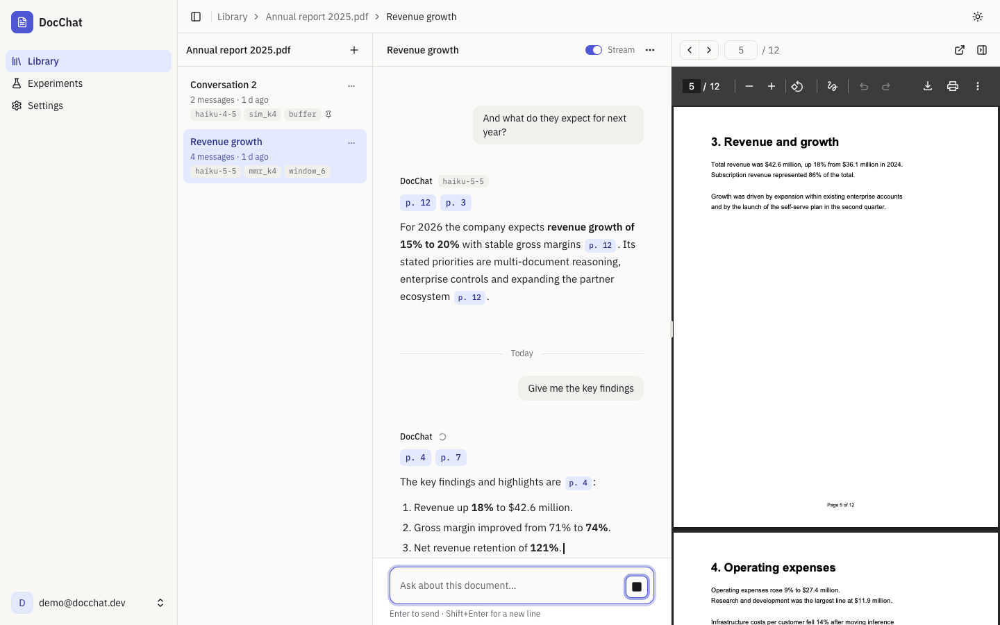
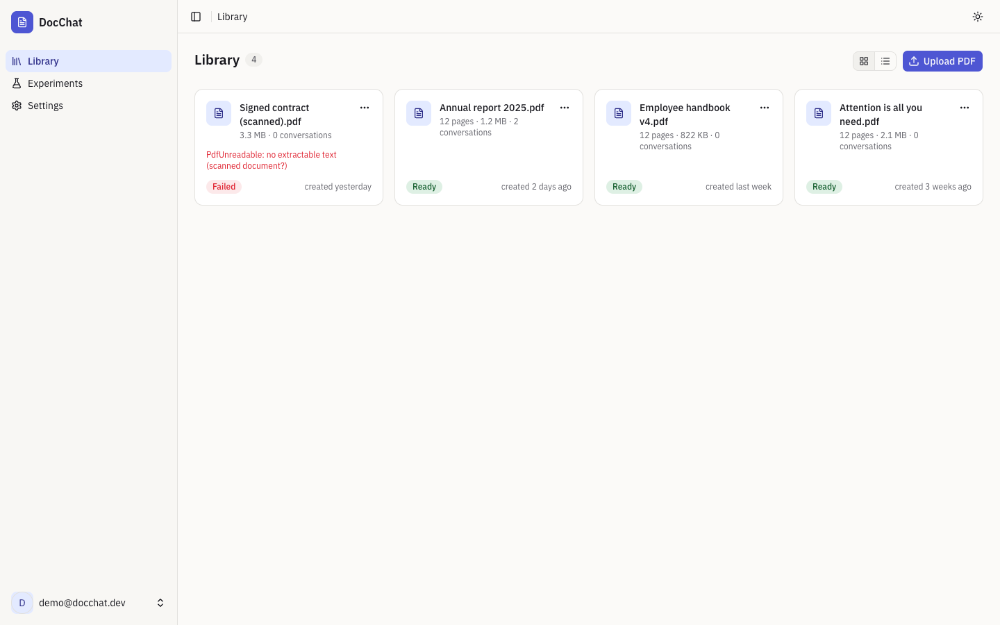
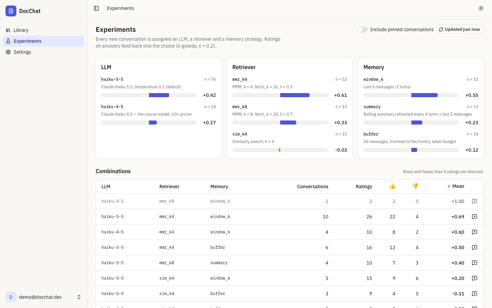
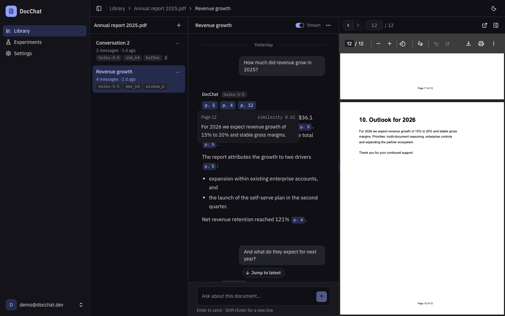

# DocChat

Chat with your PDFs — and measure which RAG setup actually works.

A multi-tenant web app where you upload PDFs and hold cited conversations about
them. Every conversation is assigned an `(llm, retriever, memory)` combination;
thumbs on answers feed back into that choice, so the app measures which
retrieval-augmented generation setup performs best.

<p align="center">
  <a href="https://www.typescriptlang.org/"></a>
  <a href="https://react.dev/"></a>
  <a href="https://vite.dev/"></a>
  <a href="https://tailwindcss.com/"></a>
  <a href="https://www.python.org/"></a>
  <a href="https://fastapi.tiangolo.com/"></a>
  <a href="https://www.anthropic.com/claude"></a>
  <a href="https://opensource.org/licenses/MIT"></a>
</p>

<p align="center">
  
</p>

<p align="center">
  
  
  
</p>

> [!NOTE]
> **Status:** the client is feature-complete and runs today against a built-in
> mock API (`pnpm dev:mock`). The FastAPI backend is being built stage by stage
> — see [Roadmap](#roadmap).

## Features

- **Library** — upload PDFs (drag and drop, progress), live ingestion status
  `pending → processing → ready | failed`, grid and table views
- **Cited answers** — every answer lists its sources; `[p.7]` markers become
  chips that open the PDF on that page, with the retrieved snippet on hover
- **Streaming** — tokens over Server-Sent Events, sources before text, Stop
  (or `Esc`) keeps the partial answer
- **Conversations per document** — history-aware follow-ups, rename, delete,
  export to Markdown
- **Experiments as a feature** — each conversation gets an LLM, retriever and
  memory arm (ε-greedy); per-answer thumbs aggregate into a dashboard
- **Cost-aware** — tokens, latency and cost under each answer; daily budget
  and usage in Settings
- **Accessible and responsive** — WCAG 2.2 AA targets, axe-checked in CI;
  three panes on desktop, sheets on tablets, tabs on phones; light and dark

## Contents

- [Tech stack](#tech-stack)
- [Architecture](#architecture)
- [Getting started](#getting-started)
- [API](#api)
- [Testing](#testing)
- [Project structure](#project-structure)
- [Roadmap](#roadmap)
- [License](#license)

---

## Tech stack

### Frontend — `client/`

|                                                                       | Technology                                                                                    | Role                                          |
| --------------------------------------------------------------------- | --------------------------------------------------------------------------------------------- | --------------------------------------------- |
|        | [React 19](https://react.dev/) + [React Compiler](https://react.dev/learn/react-compiler)     | UI runtime, automatic memoisation             |
|   | [TypeScript 6](https://www.typescriptlang.org/)                                               | Strict static typing                          |
|         | [Vite 8](https://vite.dev/)                                                                   | Dev server and bundler                        |
|  | [React Router 8](https://reactrouter.com/) (data mode)                                        | Routing, auth middleware, lazy routes         |
|   | [TanStack Query](https://tanstack.com/query)                                                  | Server state, polling, optimistic updates     |
|                                                                       | [Zustand](https://zustand.docs.pmnd.rs/)                                                      | Session, preferences and streaming drafts     |
|  | [Tailwind CSS 4](https://tailwindcss.com/)                                                    | Styling and design tokens                     |
|     | [shadcn/ui](https://ui.shadcn.com/) + [Base UI](https://base-ui.com/)                         | Accessible UI primitives                      |
|                                                                       | [react-hook-form](https://react-hook-form.com/) + [Zod 4](https://zod.dev/)                   | Forms and validation                          |
|                                                                       | [eventsource-parser](https://github.com/rexxars/eventsource-parser)                           | SSE over `fetch` (Bearer auth, POST body)     |
|  | [MSW 3](https://mswjs.io/)                                                              | Mock API for development and tests            |
|       | [Vitest](https://vitest.dev/) + [Testing Library](https://testing-library.com/)               | Unit and integration tests                    |
|                                                                       | [Playwright](https://playwright.dev/) + [axe-core](https://github.com/dequelabs/axe-core)     | End-to-end and accessibility tests            |

### Backend — `api/` (in progress)

|                                                                         | Technology                                                                                     | Role                                           |
| ----------------------------------------------------------------------- | ---------------------------------------------------------------------------------------------- | ---------------------------------------------- |
|         | [Python 3.13](https://www.python.org/) + [uv](https://docs.astral.sh/uv/)                      | Language and packaging                         |
|        | [FastAPI](https://fastapi.tiangolo.com/)                                                       | Async HTTP + SSE, OpenAPI contract             |
|      | [LangChain](https://www.langchain.com/) + [LangGraph](https://langchain-ai.github.io/langgraph/) | RAG graph: condense → retrieve → generate     |
|      | [Claude](https://www.anthropic.com/claude) + [Voyage AI](https://www.voyageai.com/)            | Generation and embeddings                      |
|     | [PostgreSQL 18](https://www.postgresql.org/) + [pgvector](https://github.com/pgvector/pgvector) | Relational data and default vector store      |
|                                                                         | [Pinecone](https://www.pinecone.io/)                                                           | Managed vector store (alternate adapter)       |
|          | [Redis 8](https://redis.io/) + [Celery](https://docs.celeryq.dev/)                             | Ingestion queue, rate limits and budgets       |
|                                                                         | [Langfuse](https://langfuse.com/)                                                              | LLM tracing and scores                         |
|     | [Kubernetes](https://kubernetes.io/) + [Kustomize](https://kustomize.io/) + [Tilt](https://tilt.dev/) | Deployment and local dev loop          |

---

## Architecture

```
┌──────────────────────────────────────────────────────────────┐
│  client/  — React SPA, feature modules                       │
│                                                              │
│  features/* ─▶ TanStack Query / Zustand ─▶ api/ (HttpClient, │
│                                            SSE, upload)      │
└──────────────────────────────────┬───────────────────────────┘
                                   │ JSON + SSE  /api/v1
┌──────────────────────────────────▼───────────────────────────┐
│  api/  — FastAPI, layered + ports                            │
│                                                              │
│  Router ─▶ Service ─▶ Repository ─▶ PostgreSQL               │
│              │                                               │
│              └─▶ rag/ (LangGraph) ─▶ VectorIndex port        │
│                                       ├─ pgvector            │
│                                       └─ Pinecone            │
└──────────────────────────────────────────────────────────────┘
        Celery worker: extract → chunk → embed → upsert
```

### Client — feature modules with a thin API layer

Five screens, one backend and no business rules beyond "is this PDF ready", so
the client is organised by feature rather than in hexagonal layers.

| Area           | Path                    | Responsibility                                                                                                      |
| -------------- | ----------------------- | ------------------------------------------------------------------------------------------------------------------- |
| **API layer**  | `src/api/`              | `HttpClient` (bearer token, single-flight refresh on 401, RFC 9457 errors → `ApiError`), SSE client, upload, types |
| **Features**   | `src/features/`         | `auth`, `library`, `workspace`, `chat`, `experiments`, `settings` — each with its components and query hooks        |
| **Stores**     | `src/stores/`           | Zustand: session (access token in memory), preferences, streaming drafts                                            |
| **UI**         | `src/components/`       | shadcn primitives and the app shell                                                                                 |
| **Mock API**   | `src/mocks/`            | MSW handlers implementing the full API contract, shared by `dev:mock` and the test suite                            |

Auth follows RFC 9700: a short-lived access JWT kept in memory and a rotating
`HttpOnly` refresh cookie; refreshes are serialised across tabs with the Web
Locks API so a reused token never revokes the session.

### API — layered with four ports

Routers only validate and delegate; services orchestrate repositories and
ports; `rag/` holds the LangGraph pipeline and depends on neither HTTP nor SQL.
The vector store, object storage, task queue and PDF extractor sit behind
ports, so CI and the demo run fully offline on pgvector while Pinecone remains
a configuration switch.

---

## Getting started

### Prerequisites

| Tool                                                               | Needed for          |
| ------------------------------------------------------------------ | ------------------- |
| [Node.js 24+](https://nodejs.org/) and [pnpm 12](https://pnpm.io/) | Client              |
| [Docker](https://www.docker.com/)                                  | Client image        |

```bash
git clone https://github.com/iandresfv/docchat.git
cd docchat/client
pnpm install
```

### Run the client with the mock API

The whole backend contract is served from [MSW](https://mswjs.io/) in the
browser — no services needed.

```bash
pnpm dev:mock       # http://localhost:5173
```

Sign in with **`demo@docchat.dev`** / **`docchat-demo`**. Data lives in the
browser's `localStorage`; clear site data to reset it.

| Try                                                     | To see                          |
| ------------------------------------------------------- | ------------------------------- |
| Upload a PDF whose name contains `scan`                 | A failed ingestion              |
| Send a message containing `/ratelimit` or `/budget`     | Rate limiting with a countdown  |
| Send a message containing `/midstream`                  | A stream that fails halfway     |
| Press `?`                                               | Keyboard shortcuts              |

### Run the client against the API

```bash
cp .env.example .env.local   # VITE_DEV_API_TARGET defaults to http://localhost:8000
pnpm dev
```

Vite proxies `/api` to the API so the refresh cookie stays same-origin.

### Container image

```bash
docker build -t docchat-client client/
docker run -p 8080:8080 -e API_UPSTREAM=http://host.docker.internal:8000 docchat-client
```

Unprivileged nginx serving the SPA on port 8080 and proxying `/api` with
buffering disabled for SSE.

---

## API

Base path `/api/v1`, bearer auth unless noted. Errors follow
[RFC 9457](https://www.rfc-editor.org/rfc/rfc9457) problem details with a
`requestId`.

| Method        | Endpoint                               | Description                                  |
| ------------- | -------------------------------------- | -------------------------------------------- |
| `POST`        | `/auth/signup` · `/auth/signin`        | Create account / sign in (public)            |
| `POST`        | `/auth/refresh` · `/auth/signout`      | Rotate the refresh cookie / revoke it        |
| `GET` `POST`  | `/pdfs`                                | List · upload (multipart, async ingestion)   |
| `GET` `DELETE`| `/pdfs/{id}`                           | Detail with presigned download URL · delete  |
| `GET` `POST`  | `/pdfs/{id}/conversations`             | List · create (optionally pinned to arms)    |
| `GET` `PATCH` `DELETE` | `/conversations/{id}`         | Messages · rename · delete                   |
| `POST`        | `/conversations/{id}/messages`         | Ask, get a cited answer                      |
| `POST`        | `/conversations/{id}/messages/stream`  | Same, streamed as Server-Sent Events         |
| `PUT` `DELETE`| `/messages/{id}/score`                 | Thumbs up/down with optional comment         |
| `GET`         | `/experiments/components` · `/summary` | Arm catalog · aggregated ratings             |
| `GET`         | `/usage/me`                            | Tokens, messages and cost today / this month |

Streaming events: `message_start` → `sources` → `delta`… → `usage` →
`message_end` (or `error`).

---

## Testing

```bash
cd client
pnpm check          # ESLint (strict, type-aware) + Prettier + tsc + Vitest
pnpm test:e2e       # Playwright + axe against a mock-mode build
pnpm test:coverage  # Vitest coverage report
```

Integration tests render whole routes against the same MSW handlers the mock
mode uses. CI runs the client job on every PR touching `client/`, and the e2e
suite nightly.

---

## Project structure

```
docchat/
├── client/                  React SPA
│   ├── src/
│   │   ├── api/             HttpClient, SSE, upload, API types
│   │   ├── features/        auth · library · workspace · chat · experiments · settings
│   │   ├── components/      ui/ (shadcn) · shared/ (shell, dialogs)
│   │   ├── stores/          Zustand stores
│   │   ├── mocks/           MSW mock API
│   │   └── lib/             env, formatting, theme, query client
│   ├── tests/               unit · integration · e2e
│   ├── Dockerfile           Node build → unprivileged nginx
│   └── nginx.conf
├── api/                     FastAPI backend (in progress)
├── assets/screenshots/      README images
├── .github/workflows/       ci.yml · e2e.yml
└── CHANGELOG.md
```

---

## Roadmap

Each milestone pairs a backend stage with the client work it unblocks and ships
as a tagged release; see [`CHANGELOG.md`](CHANGELOG.md).

| Milestone | Backend                                   | Client                 | Status          |
| --------- | ----------------------------------------- | ---------------------- | --------------- |
| v0.1.0    | Foundation (health, errors, CI)           | Scaffold               | Client ✅       |
| v0.2.0    | Ingestion core (Pinecone, Voyage)         | —                      |                 |
| v0.3.0    | Celery worker, Kubernetes, Tilt           | —                      |                 |
| v0.4.0    | Auth, PDFs, conversations                 | Auth, Library          | Client ✅       |
| v0.5.0    | LangGraph RAG pipeline                    | Workspace, chat        | Client ✅       |
| v0.6.0    | SSE streaming                             | Streaming              | Client ✅       |
| v0.7.0    | Memory strategies                         | —                      |                 |
| v0.8.0    | Experiments (ε-greedy, scoring)           | Scoring, dashboard     | Client ✅       |
| v0.9.0    | Observability (Langfuse, Prometheus)      | —                      |                 |
| v1.0.0    | pgvector, budgets, evals, prod overlay    | Image, e2e, settings   | Client ✅       |

---

## License

Released under the [MIT License](LICENSE).
